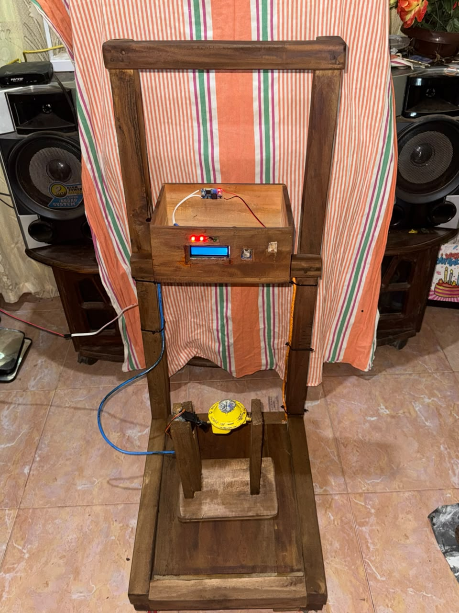
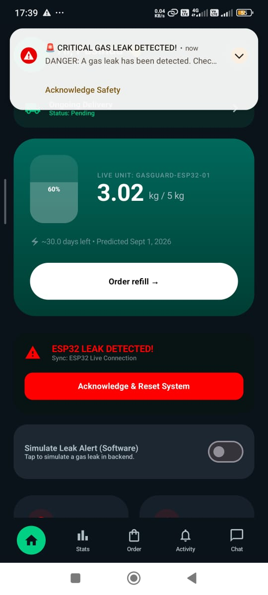
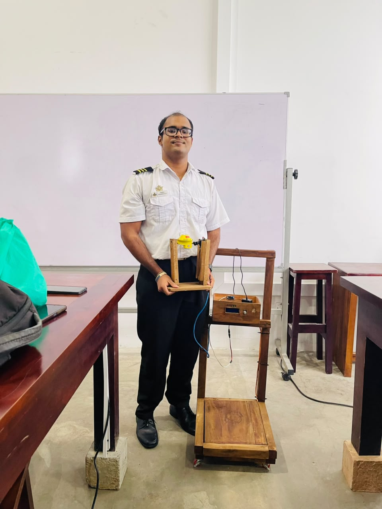

<h1 align="center">🔥 GasGuard</h1>

<p align="center">
  IoT & Machine Learning-Based LPG Monitoring and Safety System
</p>

<p align="center">
  Individual Design Project · 2026
</p>

<p align="center">
  
  
  
  
  
  
</p>

<p align="center">
  
  &nbsp;
  
</p>

<p align="center">
  Smart Monitoring · Early Detection · Safer LPG Usage
</p>

<p align="center">
  <a href="https://github.com/Lilendra-Pasindu-Harsha/GasGuard">GitHub</a>
  ·
  <a href="https://www.capcut.com/editor/DFC981D9-8CB1-4FFD-B776-7D651037730F?workspaceId=7651768553015820309&spaceId=7651767861173715985&utm_medium=Product&utm_source=draftshare&utm_campaign=link">Watch Demo</a>
</p>

---

## 📌 Overview

GasGuard combines ESP32 sensors, automatic valve control, Firebase, and a React Native app to monitor LPG usage, detect leaks, and predict refill dates.

## ✨ Features

| Safety & Monitoring | Mobile & Delivery |
|---|---|
| Live LPG weight and percentage | Customer and supplier dashboards |
| Gas leak detection and alerts | Usage and cost tracking |
| Automatic valve shutoff | ML-based refill prediction |
| Temperature and humidity | Refill ordering and order tracking |
| Local LCD and buzzer alerts | Maps, location sharing, and chat |

## 🏗️ Architecture

```text
Sensors → ESP32 → Firebase → React Native App
             ↓                        ↑
      Alarm + Valve Control     ML Predictions
```

Leak detection and valve control operate locally without internet.

## 🧰 Technology Stack

<p>
  
  
  
</p>

<p>
  
  
  
  
</p>

<p>
  
  
  
  
  
</p>

## 🔌 Hardware

| Component | Connection |
|---|---|
| ESP32 DevKit V1 | Main controller |
| MQ-5 | GPIO 34 |
| DHT22 | GPIO 27 |
| 20 kg Load Cell + HX711 | DT: 25 · SCK: 26 |
| 16×2 I²C LCD | SDA: 21 · SCL: 22 |
| MG995 Servo | GPIO 13 |
| Buzzer | GPIO 19 |
| Green / Red LEDs | GPIO 23 / 32 |
| LM2596 | Voltage regulation |

Servo: separate regulated power line with common ground.

## 🚨 Leak Response

```text
Gas Detected
     ↓
Red LED + Buzzer + LCD Warning
     ↓
Servo Closes Valve
     ↓
Firebase Event + Mobile Alert
```

## 🤖 Depletion Prediction

| Item | Result |
|---|---|
| Model | Multiple Linear Regression |
| Dataset | 180 records · 5 kg cylinder |
| Inputs | 9 engineered features |
| Train / Test | 80% / 20% |
| Test R² | 0.9883 |
| MAE | 1.618 days |
| RMSE | 1.877 days |
| 5-Fold CV R² | 0.9316 ± 0.1093 |

Inputs include LPG weight, usage rate, rolling consumption, and refill history.

Limited dataset; performance across other households and cylinder sizes is not established.

## 📂 Repository

```text
GasGuard/
├── assets/
├── Database/
├── GasGuard_App/
├── GasGuard_App Apk/
├── GasGuard_Diagnostics_Tools/
├── GasGuard_ML/
├── NewFullcode/
├── Testing_Codes/
├── LICENSE
└── README.md
```

## 🚀 Quick Start

### Firmware

Open `NewFullcode/` in Arduino IDE, install dependencies, configure Wi-Fi/Firebase, and upload to ESP32.

### Mobile App

```bash
cd GasGuard_App
npm install
npx react-native run-android
```

Configure Firebase and Google Maps before running.

### Machine Learning

```bash
cd GasGuard_ML
pip install numpy pandas scikit-learn matplotlib
python gasguard_model_training.py
```

## 📸 Gallery

<p align="center">
  
  
  
</p>

## 🔮 Next Steps

- Larger datasets and multiple cylinder sizes
- Battery backup and improved weight filtering
- Valve-fault monitoring
- Stronger authentication and Firebase App Check
- Long-term testing and delivery tracking

## 🔐 Security

Keep credentials out of Git. Configure Firebase Authentication, database rules, and API-key restrictions.

## ⚠️ Safety

Educational prototype - not a certified LPG safety system. Do not use it as a replacement for certified detectors, approved valves, or professional inspections.

## 👨‍💻 Developer

WALP Harsha  
Electronics & Telecommunication Engineering Undergraduate  
General Sir John Kotelawala Defence University · Sri Lanka 🇱🇰

## 📄 License

See [LICENSE](LICENSE).

---

<p align="center">
  🔥 GasGuard · Smart Monitoring. Early Detection. Safer LPG Usage.
</p>
